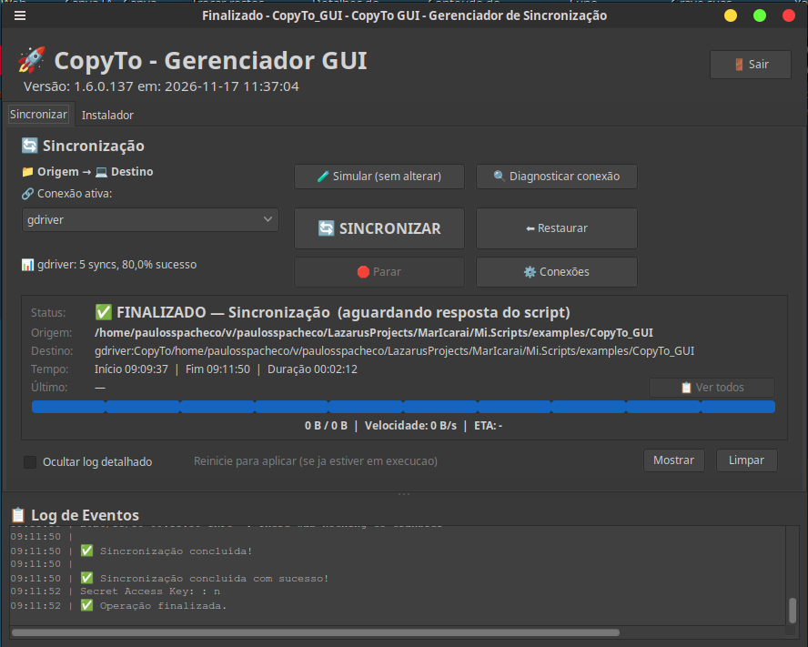

# CopyTo — Manual do Usuário

**Versão do programa descrita aqui:** 1.6.0.137 (17/11/2026)

---

## 1. O que é o CopyTo

O CopyTo guarda uma **cópia de segurança das suas pastas na nuvem** (Google Drive, OneDrive, Dropbox e outros) ou em outro lugar de sua escolha, como um disco do computador ou o celular.

Você escolhe uma pasta, clica em **SINCRONIZAR**, e o CopyTo envia para a nuvem o que é novo ou mudou.p

Três ideias para guardar:

- **A cópia vai do seu computador para a nuvem.** A sua pasta é sempre a original.
- **Nada some de vez.** Arquivos que você alterou ou apagou no computador não são destruídos na nuvem: vão para uma **pasta de backup** no mesmo serviço.
- **Você pode simular antes.** O botão **Simular** mostra o que seria feito, sem mexer em nada.

---

## 2. O que você precisa

- Um computador com o CopyTo GUI instalado.
- Conexão com a internet (menos quando o destino for um disco do próprio computador).
- Uma conta no serviço onde vai guardar as cópias (por exemplo, uma conta Google para o Google Drive).

O CopyTo usa três programas de apoio: **Bash**, **rclone** e **jq**. O botão **Instalar** (seção 3) cuida deles para você.

---

## 3. Primeiro uso

Ao abrir o programa pela primeira vez, ele mostra a aba **Instalador**. Há dois passos: instalar e conectar um serviço.

### 3.1 Instalar o CopyTo

1. Na aba **Instalador**, veja a linha de estado. Se estiver escrito **⚠️ CopyTo NÃO Instalado**, clique em **Instalar**.
2. Acompanhe o andamento no **Log de Eventos**, na parte de baixo da janela.
3. Quando terminar, a linha de estado passa a mostrar **✅ CopyTo Instalado**, com a data e o usuário.

Ao lado, o programa mostra se as ferramentas necessárias estão presentes: **✅ Bash | ✅ rclone | ✅ jq**. Um ❌ indica que falta alguma delas. Clique em **Instalar** de novo para corrigir.

No Windows, o Git Bash é instalado automaticamente, se necessário.

Se você clicar em **Atualizar** a qualquer momento, o programa confere de novo o estado da instalação.

### 3.2 Conectar um serviço (provider)

Um **provider** (ou **conexão**) é o lugar onde as cópias ficam guardadas.

1. Na aba **Instalador**, abra a lista de conexões.
   - Itens com **✅** já estão configurados.
   - Os demais estão disponíveis para adicionar.
2. Escolha o serviço desejado e clique em **Adicionar**.
3. Siga o que o programa pedir. Depende do serviço:

| Serviço | O que acontece |
|---|---|
| **Google Drive** (`gdriver`), **OneDrive**, **Dropbox** | O programa avisa que vai abrir o navegador. Confirme, entre na sua conta e autorize o acesso. |
| **IDrive E2**, **Backblaze B2** | Pedem os dados da conta: endereço (endpoint), região, nome do bucket e as chaves de acesso. Você os encontra no painel do serviço. |
| **Pasta local** (`local`) | Pede a pasta onde as cópias serão guardadas, por exemplo em um HD externo. |
| **Celular** | Veja a seção 10. |

4. Depois de adicionar, o serviço aparece com **✅** na lista e já pode ser usado na aba **Sincronizar**.

Para **remover** uma conexão, escolha-a na lista (ela precisa estar com ✅) e clique em **Remover**. Os arquivos que já estão na nuvem **não são apagados**.

> **Dica:** se você acabou de instalar e ainda não tem nenhuma conexão, o programa pode perguntar **"Onde guardar suas cópias?"** com as opções **Google Drive**, **OneDrive** ou **Configurar depois**.

---

## 4. Sincronizar uma pasta

A aba **Sincronizar** é a tela do dia a dia.

### 4.1 Passo a passo

1. Abra a aba **Sincronizar**.
2. Em **Conexão ativa**, escolha onde guardar a cópia (por exemplo, `gdriver`). O CopyTo lembra a última escolha.
3. Clique em **SINCRONIZAR**.
4. Escolha a **pasta do seu computador** que será copiada e confirme.
5. Aguarde. Você acompanha tudo no painel da operação e no log.

Enquanto trabalha, o programa **bloqueia os botões** para evitar duas operações ao mesmo tempo. Eles voltam ao normal quando terminar.

### 4.2 Onde as cópias ficam na nuvem

A nuvem repete o caminho completo da pasta no seu computador, dentro de uma pasta chamada `CopyTo`. Exemplo do print abaixo:

- **Origem:** `/home/paulosspacheco/v/paulosspacheco/LazarusProjects/MarIcarai/Mi.Scripts/examples/CopyTo_GUI`
- **Destino:** `gdriver:CopyTo/home/paulosspacheco/v/paulosspacheco/LazarusProjects/MarIcarai/Mi.Scripts/examples/CopyTo_GUI`

Assim, pastas com o mesmo nome em lugares diferentes nunca se misturam.

### 4.3 Lendo a tela



*Exemplo: sincronização concluída com sucesso.*

| Parte da tela | O que significa |
|---|---|
| **Título da janela** (`Finalizado - CopyTo_GUI ...`) | Mostra o estado mesmo com a janela minimizada: `NN%`, `Processando`, `Finalizado`, `Finalizado com erro` ou `Interrompido`. Você acompanha pela barra de tarefas. |
| **Conexão ativa** | O serviço escolhido. Abaixo dele, um resumo: `gdriver: 5 syncs, 80,0% sucesso` — quantas sincronizações já foram feitas com ele e quantas deram certo. |
| **Status** | A fase atual (veja a tabela 4.4), seguida do nome da operação. |
| **Origem / Destino** | De onde sai e para onde vai a cópia. Caminhos longos são encurtados para caber na tela. |
| **Tempo** | Durante a cópia: hora de início e tempo decorrido. Depois: `Início`, `Fim` e `Duração`. |
| **Último** | O último arquivo tratado, com a ação: **Copiado**, **Alterado**, **Movido** ou **Apagado**. Mostra `—` quando nenhum arquivo foi tratado. |
| **Ver todos (N)** | Abre a lista de todos os arquivos da operação. Fica apagado enquanto não há arquivos. |
| **Barra de progresso** | Mostra o avanço. Quando o programa ainda não sabe o percentual, ela fica correndo de um lado a outro. |
| **Linha abaixo da barra** | Bytes enviados e total, velocidade e tempo restante (ETA). No exemplo: `0 B / 0 B | Velocidade: 0 B/s | ETA: -`. |

**O que o exemplo mostra:** a sincronização terminou (**FINALIZADO**), levou 2 minutos e 12 segundos e **não enviou nenhum byte**. Isso é normal quando a pasta já estava toda na nuvem, sem arquivos novos ou alterados. O programa gasta esse tempo conferindo se está tudo igual.

### 4.4 As fases de uma operação

| Status | Significado |
|---|---|
| **Pronto** | Nada em andamento. |
| **AGUARDANDO CONFIRMAÇÃO** | O programa espera uma resposta sua antes de começar. Leia a pergunta e responda. |
| **PROCESSANDO** | Em andamento. |
| **FINALIZADO** | Terminou bem. |
| **FINALIZADO COM ERRO** | Terminou com problema. Leia o log (seção 8) e veja a seção 12. |
| **INTERROMPIDO** | Você mandou parar. |

---

## 5. Simular (sem alterar nada)

**Simular (sem alterar)** faz todo o trabalho de conferência, mas **não envia, não move e não apaga nada**. É a melhor forma de ver o que a sincronização faria.

1. Escolha a conexão.
2. Clique em **Simular (sem alterar)**.
3. Escolha a pasta.
4. Ao final, o painel resume o que aconteceria:
   - **seriam copiados**: arquivos novos que subiriam;
   - **seriam movidos p/ backup**: arquivos alterados ou removidos no computador;
   - **datas a alterar**: só a data do arquivo mudaria.

Sem nada a fazer, aparece: *"Nenhum arquivo seria copiado ou movido para o backup."* Use **Ver todos** para a lista completa.

> Recomendado na primeira vez que você sincroniza uma pasta, ou depois de apagar muita coisa no computador.

---

## 6. Diagnosticar a conexão

**Diagnosticar conexão** testa se tudo está funcionando: confere o rclone e a configuração do serviço, testa o login, as permissões e a pasta raiz, e mostra informações úteis em caso de problema.

Não pede pasta e não altera nenhum arquivo. Use quando a sincronização falhar ou depois de ficar muito tempo sem usar.

---

## 7. Restaurar (trazer arquivos de volta)

**Restaurar** copia da nuvem de volta para o seu computador.

1. Clique em **Restaurar**.
2. Uma janela mostra as pastas guardadas na nuvem. **Escolha a pasta** que deseja recuperar.
3. Escolha a **pasta do computador** onde os arquivos serão colocados. O programa cria dentro dela uma subpasta com o nome da pasta recuperada. Se o destino não existir, ele pergunta se deve criá-lo.
4. Aguarde o fim. O andamento aparece como em qualquer sincronização.

**A restauração é segura:**

- só traz arquivos que **ainda não existem** no computador;
- **nunca substitui** um arquivo que você já tem;
- **nunca apaga** nada no seu computador.

---

## 8. O Log de Eventos

A parte de baixo da janela registra tudo o que o programa faz, com a hora de cada linha. É o primeiro lugar para olhar quando algo não saiu como esperado.

- Ao começar uma nova operação, o log é **limpo automaticamente**.
- **Limpar** apaga o log na hora.
- **Ocultar log detalhado** esconde o log para deixar a tela mais limpa. O botão **Mostrar** o traz de volta.
- Você pode **arrastar a divisória** entre as abas e o log para dar mais espaço a um deles.

Ao fim de cada operação, o log mostra um quadro: **✅ SUCESSO** ou **❌ FALHOU**.

---

## 9. Parar uma operação

Clique em **Parar** para interromper o que está em andamento. O status muda para **INTERROMPIDO**.

Se você tentar **fechar a janela** com uma operação rodando, o programa pergunta:

- **Sair mesmo assim** — interrompe e fecha;
- **Continuar** — volta ao programa (é a opção padrão).

> **Atenção:** a **instalação** não pode ser interrompida com segurança. Sair no meio dela pode deixar o CopyTo incompleto. Aguarde terminar.

---

## 10. Guardar as cópias no celular (Android)

O CopyTo pode copiar suas pastas para o armazenamento do celular, pela rede Wi-Fi da sua casa. O computador e o celular precisam estar no **mesmo Wi-Fi**.

### 10.1 No celular (uma única vez)

1. Instale o **Termux pela Google Play Store** (Android 11 ou superior). Se já tiver o Termux instalado por outra origem, desinstale antes.
2. Abra o Termux e execute o script de configuração indicado na documentação do provider `celular`. Ele explica cada passo e, no final, mostra um quadro com **IP, porta, usuário e senha**. Anote esses dados.

### 10.2 No computador

1. Na aba **Instalador**, escolha **celular** e clique em **Adicionar**.
2. Informe o **IP**, a **porta** (normalmente `8022`), o **usuário** e a **senha** do quadro.
3. O programa testa a conexão. Se funcionar, o provider fica pronto.

### 10.3 Antes de cada sincronização

- o celular está ligado e no mesmo Wi-Fi;
- o **Termux está aberto** (não o feche deslizando-o na lista de apps);
- a tela fica ligada durante a cópia.

As cópias ficam em uma pasta `CopyTo` no armazenamento interno do celular. Use o app **Arquivos** para encontrá-la.

> Se o roteador mudar o IP do celular, o CopyTo tenta achá-lo sozinho. O mais simples é reservar um IP fixo para o celular nas configurações do roteador.

---

## 11. Outras formas de usar

### 11.1 Pela linha de comando

Quem prefere atalhos pode abrir a sincronização de uma pasta direto do terminal ou de um atalho:

```
copytogui --sync-folder <conexão> [pasta]
```

- Sem a pasta, usa a pasta atual.
- Se o programa já estiver aberto, a janela existente recebe o pedido e começa a sincronizar.
- Se já houver uma operação em andamento, o programa avisa e pede que você espere.

### 11.2 Atalhos

A instalação cria atalhos do CopyTo GUI no seu sistema. Eles são removidos na desinstalação.

---

## 12. Problemas comuns

| Sintoma | O que fazer |
|---|---|
| Os botões **SINCRONIZAR**, **Simular**, **Diagnosticar** e **Restaurar** estão apagados | Veja a mensagem em **Estatísticas**: *"Instale o CopyTo primeiro"* (use a aba **Instalador**) ou *"Configure um provider primeiro"* (adicione uma conexão). Se houver outra operação rodando, espere ela terminar. |
| Aviso **"Limite temporário do Google Drive"** | O Google limitou os pedidos por um tempo. Espere alguns minutos e tente de novo. Os arquivos já copiados são mantidos. |
| **FINALIZADO COM ERRO** | Clique em **Diagnosticar conexão** e leia o log. Os erros mais comuns são internet fora do ar, autorização vencida (adicione a conexão de novo) e falta de espaço na nuvem. |
| A tela mostra **"(aguardando resposta do script)"**, mas o log já diz **"Operação finalizada"** | A cópia terminou. Pode seguir usando o programa normalmente. |
| Navegador não abriu ao adicionar o Google Drive | Confirme que há um navegador padrão e tente adicionar de novo. |
| Celular: **Não foi possível conectar** | Abra o Termux, confira o IP e confirme que os dois aparelhos estão no mesmo Wi-Fi. |
| Celular: parou no meio da cópia | O Android pode ter encerrado o Termux. Abra-o de novo, mantenha a tela ligada e sincronize outra vez. |

---

## 13. Desinstalar

1. Abra a aba **Instalador**.
2. Clique em **Desinstalar**. O programa lista o que será removido (conexões, ferramentas de apoio e arquivos de configuração) e pede confirmação.
3. Ao final, o CopyTo GUI **fecha sozinho**.

**Seus arquivos na nuvem e no computador não são apagados.** Só os programas e as configurações do CopyTo são removidos.

---

## 14. Cuidados e segurança

- Mantenha **suas contas e senhas protegidas**. As chaves de acesso de serviços como IDrive E2 e Backblaze B2 dão acesso total aos seus arquivos: não as compartilhe.
- Para o celular, use o servidor apenas em **redes Wi-Fi de confiança**, como a da sua casa. Fora dela, mantenha-o desligado.
- Para **ver o que vai acontecer** antes de sincronizar algo importante, use sempre **Simular**.
- Faça uma **restauração de teste** de vez em quando, para ter certeza de que suas cópias estão boas.

---

## 15. Glossário

| Termo | Significado |
|---|---|
| **Provider / Conexão** | O serviço ou lugar onde as cópias são guardadas. |
| **Sincronizar** | Deixar a nuvem igual à sua pasta: envia o que é novo ou mudou. |
| **Simular** | Mostrar o que seria feito, sem fazer. |
| **Restaurar** | Trazer arquivos da nuvem de volta ao computador. |
| **Backup** | Pasta, no mesmo serviço, que guarda os arquivos alterados ou removidos. |
| **Log** | Registro, linha a linha, do que o programa fez. |
| **ETA** | Tempo estimado para terminar. |
| **rclone** | Programa de apoio que faz a transferência dos arquivos. |
