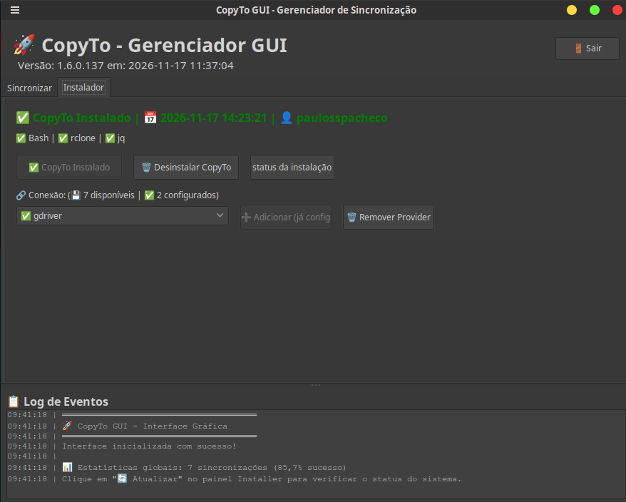

# CopyTo GUI — Aba Instalador

**Versão do programa descrita aqui:** 1.8.0 (21/11/2026)

A aba **Instalador** é onde você **prepara o CopyTo** para funcionar: instala o programa, confere as ferramentas de apoio e escolhe **onde guardar suas cópias** (as conexões, também chamadas de *providers*). Ela fica ao lado da aba **Sincronizar**, que é a tela do dia a dia.

Também dá para chegar aqui pelo botão **⚙️ Conexões**, na aba **Sincronizar**.

---

## 1. Visão geral da tela

*Exemplo: CopyTo instalado e com duas conexões configuradas.*

| Parte da tela | O que mostra |
|---|---|
| **Título e versão** (topo da janela) | Nome do programa, versão e data de geração. Não pertencem à aba: aparecem em todas. O botão **Sair** também. |
| **Linha de estado** | `✅ CopyTo Instalado \| 📅 data \| 👤 usuário` (em verde) quando instalado, ou `⚠️ CopyTo NÃO Instalado` (em marrom). A data e o usuário são os da instalação. |
| **Ferramentas de apoio** | `✅ Bash \| ✅ rclone \| ✅ jq`. Um **❌** indica que aquela ferramenta não foi encontrada. |
| **Botões de instalação** | **Instalar**, **Desinstalar** e **status da instalação** (seção 2). |
| **Resumo das conexões** | `🔗 Conexão: (💾 7 disponíveis \| ✅ 2 configurados)`: quantos serviços ainda podem ser adicionados e quantos já estão prontos. |
| **Lista de conexões** | Os serviços, com os botões **Adicionar** e **Remover** ao lado (seção 3). |
| **Log de Eventos** (parte de baixo) | O registro de tudo o que o programa faz. Veja o Manual do Usuário, seção 8. |

### 1.1 As ferramentas de apoio

O CopyTo depende de três programas pequenos. Você não precisa instalá-los à mão: o botão **Instalar** cuida disso.

| Ferramenta | Para que serve |
|---|---|
| **Bash** | Executa os scripts do CopyTo. No Windows, o CopyTo instala o *Git Bash* para você, se for preciso. |
| **rclone** | Faz a transferência dos arquivos para a nuvem. |
| **jq** | Lê e organiza os dados de configuração. |

---

## 2. Os botões de instalação

Os botões mudam de texto e ficam **apagados** (sem resposta ao clique) quando não fazem sentido naquele momento. Isso evita erros.

| Botão | Quando está ativo | O que faz |
|---|---|---|
| **🚀 Instalar CopyTo** | Só se o CopyTo **não** está instalado | Instala as ferramentas de apoio, cria os atalhos do CopyTo GUI e, ao final, confere o estado. |
| **✅ CopyTo Instalado** | (é o mesmo botão, já apagado) | Mostra que a instalação está feita. Não há nada a clicar. |
| **🗑️ Desinstalar CopyTo** | Só se o CopyTo **está** instalado | Remove o CopyTo (seção 5). |
| **status da instalação** | Sempre, se nada estiver em andamento | Confere de novo se o CopyTo está instalado, se as ferramentas existem e quais conexões estão configuradas. Atualiza toda a tela. |

**Todos** os botões e a lista de conexões ficam apagados enquanto uma operação está em andamento, mesmo que ela esteja na aba **Sincronizar**. Voltam ao normal quando termina.

---

## 3. Conexões (onde guardar as cópias)

Uma **conexão** é o serviço ou o lugar onde as cópias ficam: Google Drive, OneDrive, Dropbox, uma pasta do computador, o celular e outros.

### 3.1 A lista

A lista tem até duas partes, separadas por uma linha `─────────────`:

1. **Serviços disponíveis**, ainda não configurados. Aparecem só com o nome, por exemplo `dropbox`.
2. **Serviços já configurados**, marcados com **✅**, por exemplo `✅ gdriver`.

O CopyTo lembra a última conexão que você escolheu e a seleciona de novo na próxima vez.

### 3.2 Adicionar uma conexão

1. Abra a lista e escolha um serviço **sem** o ✅.
2. Clique em **➕ Adicionar**.
3. Siga o que o programa pedir:

| Serviço | O que acontece |
|---|---|
| **Google Drive** (`gdriver`), **OneDrive**, **Dropbox** | O programa avisa que vai abrir o navegador. Confirme, entre na sua conta e autorize o acesso. |
| **IDrive E2**, **Backblaze B2** | Pedem os dados da conta (endereço, região, nome do bucket e chaves de acesso), que você encontra no painel do serviço. |
| **Pasta local** (`local`) | Pede a pasta onde as cópias serão guardadas, por exemplo em um HD externo. |
| **Celular** | Veja a seção 10 do Manual do Usuário. |

4. Ao terminar, o serviço passa a aparecer com **✅**, o resumo das conexões é atualizado e ele já pode ser usado na aba **Sincronizar**.

Se o serviço **já está configurado**, o botão fica apagado e mostra **➕ Adicionar (já configurado)**.

### 3.3 Remover uma conexão

1. Escolha na lista um serviço **com ✅**.
2. Clique em **🗑️ Remover Provider** e confirme.

**Os arquivos que já estão na nuvem não são apagados.** Só a ligação do CopyTo com o serviço é desfeita.

### 3.4 Quando os botões de conexão ficam apagados

Os textos dos botões explicam o motivo:

| Situação | Botão | Texto |
|---|---|---|
| CopyTo não instalado | Adicionar | **➕ Adicionar (instale o CopyTo primeiro)** |
| Serviço escolhido já configurado | Adicionar | **➕ Adicionar (já configurado)** |
| Nada escolhido na lista | Remover | **🗑️ Remover (selecione um provider)** |
| Serviço escolhido ainda não configurado | Remover | Fica apagado: só se remove o que já foi adicionado |

---

## 4. Primeiro uso, passo a passo

1. Abra o programa. Se aparecer **⚠️ CopyTo NÃO Instalado**, clique em **🚀 Instalar CopyTo**.
2. Acompanhe o **Log de Eventos**. Não feche a janela até terminar: a instalação não pode ser interrompida com segurança.
3. Quando a linha ficar verde com **✅ CopyTo Instalado** e as três ferramentas aparecerem com ✅, a instalação terminou.
4. O programa pode perguntar **"Onde guardar suas cópias?"**, com as opções **Google Drive**, **OneDrive** ou **Configurar depois**. Escolha um serviço para adicioná-lo agora, ou deixe para depois pelo botão **➕ Adicionar**.
5. Vá para a aba **Sincronizar** e use a conexão configurada.

---

## 5. Desinstalar

1. Clique em **🗑️ Desinstalar CopyTo**.
2. O programa lista o que será removido (conexões, ferramentas de apoio e arquivos de configuração) e pede confirmação.
3. Ao final, os atalhos são removidos e o CopyTo GUI **fecha sozinho**.

**Seus arquivos, na nuvem e no computador, não são apagados.** Só os programas e as configurações do CopyTo são removidos.

---

## 6. Problemas comuns

| Sintoma | O que fazer |
|---|---|
| Aparece **❌** ao lado de Bash, rclone ou jq | Clique em **🚀 Instalar CopyTo** de novo. Se o botão estiver apagado, use **status da instalação** para atualizar a tela. |
| A tela parece desatualizada (botões que não combinam com o estado) | Clique em **status da instalação**. |
| Todos os botões estão apagados | Há uma operação em andamento, talvez na aba **Sincronizar**. Aguarde terminar. |
| O navegador não abriu ao adicionar Google Drive, OneDrive ou Dropbox | Confirme que há um navegador padrão e tente **➕ Adicionar** de novo. |
| **➕ Adicionar** está apagado | Veja o texto do botão: ou falta instalar o CopyTo, ou o serviço já está configurado. |
| A lista de conexões está vazia | Instale o CopyTo e clique em **status da instalação**. |